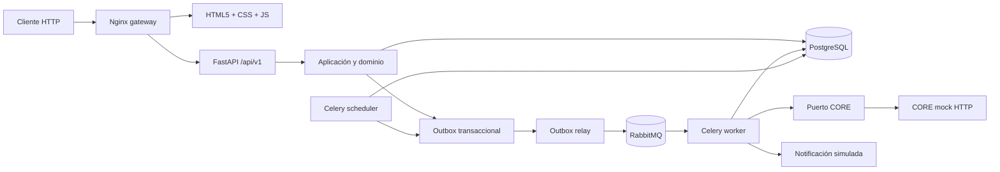
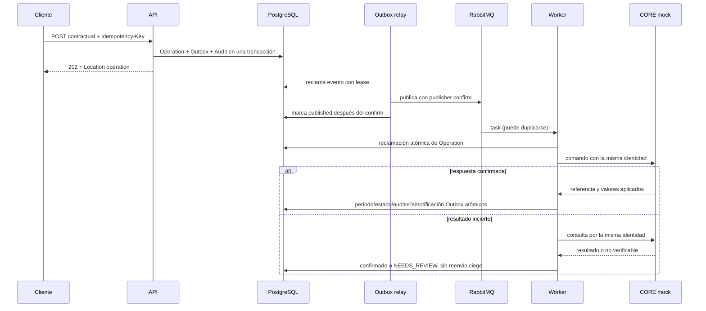
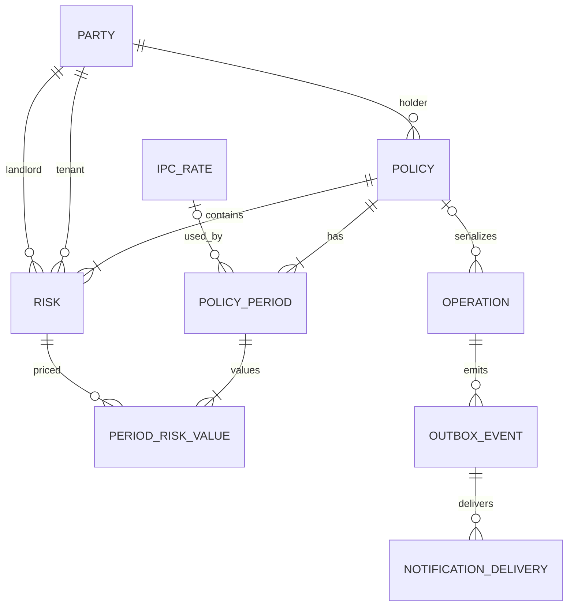

# Arquitectura

## Límites

Un solo servicio FastAPI contiene los módulos lógicos de pólizas, riesgos, renovaciones, operaciones y auditoría. Dominio calcula invariantes y economía con Python/Decimal; aplicación administra transacciones; los adaptadores conectan PostgreSQL, el mock CORE HTTP y el canal de notificación simulado. Celery procesa comandos persistidos y el scheduler es un proceso independiente.

## Flujo de modificación

## Modelo principal

`Policy.policy_type` discrimina individual/colectiva. No hay tablas por subtipo ni herencia ORM. Valores económicos son históricos por periodo y riesgo; una renovación conserva origen, destino, IPC, snapshot, prima/regla y valores reportados por CORE.
`AuditEvent` guarda `entity_type/entity_id` y `correlation_id` sin FK polimórfica.

## Contrato HTTP y errores

| HTTP | Significado en esta API |
|---|---|
| `400` | Error de dominio general que no tiene una categoría más específica. |
| `401` | Falta Bearer token o no corresponde a los tokens de demo configurados. |
| `403` | Token válido sin rol requerido (`read`, `operator` o `reviewer`). |
| `404` | Party, póliza, riesgo, IPC u operación no encontrada. |
| `409` | Conflicto de negocio, reserva pendiente, último riesgo o Idempotency-Key con otro contenido. |
| `422` | JSON/campo inválido o regla de negocio incumplida. Una renovación sin IPC queda `WAITING_INPUT`. |

FastAPI publica modelos y validaciones en `/openapi.json`; Swagger está en `/docs`. La paginación de pólizas limita `limit` a 100 y ordena por creación e ID para estabilidad. `PATCH /policies/{id}` solo permite `notes`.

## Estados de operación y recuperación

| Estado | Significado | Transiciones permitidas |
|---|---|---|
| `PENDING` | Persistida, pendiente de worker | `PROCESSING` |
| `WAITING_INPUT` | Falta el IPC explícito | `PENDING` al aportar IPC, o permanece |
| `PROCESSING` | Worker reclamó con lease | `SUCCEEDED`, `REJECTED`, `NEEDS_REVIEW`, o `RECONCILING` al vencer lease |
| `RECONCILING` | Solo consulta CORE; no reenvía | `SUCCEEDED`, `NEEDS_REVIEW` |
| `SUCCEEDED` | Confirmada y persistida localmente | Terminal |
| `REJECTED` | Rechazo de negocio confirmado | Terminal |
| `NEEDS_REVIEW` | Resultado externo o discrepancia sin resolución automática | Reconciliación administrativa; no reenvío |

Una respuesta `202` significa únicamente aceptación durable. Una clave idempotente repetida con el mismo hash devuelve la operación existente; con otro hash produce `409`. El lock de fila de Policy y una operación pendiente serializan cambios incompatibles. La restricción única `policy_id + operation_type + target_period_start` protege renovaciones repetidas.

Outbox y Operation se insertan en la misma transacción. El relay marca publicación luego de confirmación del broker; si publica y cae antes de marcar, habrá posible entrega duplicada. El worker reclama de forma atómica, y las tareas de notificación deduplican por evento/canal/destinatario. No se afirma ejecución exactamente una vez.

El lease vencido de un worker provoca una consulta al CORE con la misma identidad. Un `404` no se interpreta como permiso para repetir la mutación: queda `NEEDS_REVIEW`. El endpoint reviewer `/api/v1/operations/{id}/reconcile` consulta sin reenviar.

## Docker y capacidad

API, worker, scheduler, relay, migración, seed, demo y tests usan la imagen Python fijada. Un perfil de herramientas aporta un cliente cURL en contenedor para que no haga falta instalarlo en el host. PostgreSQL/RabbitMQ/CORE mock tienen servicios y healthchecks separados; el CORE mock no publica puertos. Solo gateway Nginx publica el puerto 8080. PostgreSQL y broker tienen volúmenes locales persistentes.

`/health/live` no accede a dependencias; `/health/ready` prueba PostgreSQL. `/metrics` expone contadores/latencia HTTP y gauges agregados de cantidad, antigüedad e intentos de operación por estado, sin IDs como etiquetas.

El worker configura concurrencia por proceso; agregar réplicas multiplica el presupuesto estimado hacia CORE. No existe coordinador de tasa distribuido. Mantener un solo scheduler. Esto es topología demostrativa de Docker Compose, no HA ni disponibilidad 24/7.
